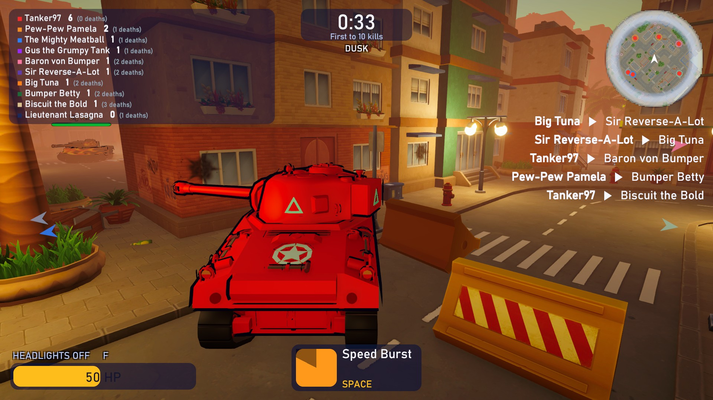

# Tanks Mate 2: Toon Tanks

A toony, arcade LAN tank battle for Windows PC: up to 4 players and 10 tanks, every tank for itself or Red against Blue.
Drive through a resort town, aim with the mouse or a gamepad, blast your friends, flatten palm trees, shove cars out of
the way and grab power-ups. Bots fill the empty seats, so you can play alone too.

## Download

**[TanksMateToon-v0.2.30.zip](https://github.com/thepetshark/petshark-public-downloads/releases/download/tanks-mate-toon-v0.2.30/TanksMateToon-v0.2.30.zip)** (105 MB), version 0.2.30, 2026-10-12. Free to download and play.

This is an early version: it is still being made, and it changes often.

SHA-256: `d48bc75ea0d96685d4de6cd04349c485c27e6e1de0862238e54686b8bbd5fb1e`

## How to play

1. Unzip the download anywhere and keep the folder together.
2. Run `TanksMateToon\TanksMateToon.exe`. The game is not code-signed, so Windows may say "Windows protected your PC":
   choose "More info", then "Run anyway".
3. Alone: choose Quick Match (bots that fight) or Practice (bots that never shoot).
4. With others on the same home network: one PC chooses Host a game; the others see it under Games on your network, or
   type the host's address (shown in the host's lobby) under Join by IP.
5. The PC that hosts must let the game through Windows Firewall when Windows asks (private networks). The game uses UDP
   47777 to be found and UDP 7777 to play.
6. Everyone playing together needs the same version. It is shown at the bottom right of the main menu.

## Controls

| Action | Keyboard and mouse | Gamepad |
|---|---|---|
| Drive and steer | W A S D or the arrow keys | Left stick |
| Aim | Mouse | Right stick |
| Fire (hold) | Left mouse button | Right trigger |
| Use ability | Space | Left shoulder |
| Zoom | Mouse wheel | Hold left trigger |
| Sniper view | Middle mouse button | Left stick click |
| Switch the camera view | Right mouse button | Right stick click |
| Look around (hold) | Left Ctrl | Right shoulder |
| Pause | Esc | Start |
| Show the controls (hold) | F1 | Back |

## Good to know

- Windows 10 or 11, 64-bit. Play is on your own network: there is no internet matchmaking.
- The game collects no data. While you host or look for games it announces your player name on your own network only.
- There are no automatic updates: come back to this page for newer versions.

## New in 0.2.30

- The Homing Missile goes round buildings to its target, and picks a tank it can see first.
- The town behind the main menu and the lobby stands on finished ground, with a wall between the buildings.
- On the Scout, the Galaxy moon and the Jolly Roger skull sit ahead of the turret's triangle.

(c) 2026 Pet Shark Productions Inc. All rights reserved.
